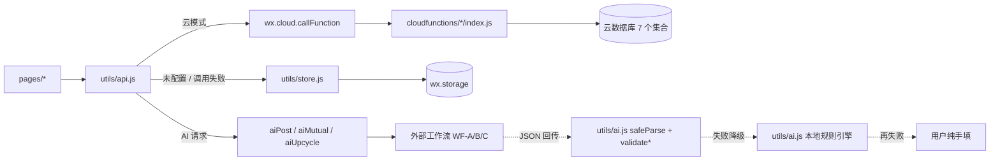

# AI宿造局 · 代码导读

> 面向接手这份工程的开发者。依据 `../AI宿造局-项目开发文书.md` 实现，技术栈是**原生微信小程序（无框架、无构建步骤）+ 微信云开发**（云函数 Node.js 16 / `wx-server-sdk`）。
>
> 工程目录：`E:\AI宿造局\miniprogram\`　辅助脚本：`E:\AI宿造局\tools\`

**当前状态（2026-11-18）**：已绑定正式 AppID `wx4123c75f472af62d`、云环境 `cloud1-d6get99l6f8cb27d7`，20 个云函数已部署且全部 `Active`，7 个集合与种子数据已就绪。AI 已**真实接入腾讯云 TokenHub**（视觉 `hy-vision-2.0-instruct` / 文本 `hy4-flash`）；`app.json` 默认不声明微信同声传译插件，避免后台未授权导致模拟器启动失败，语音走云端 ASR（第 13 章）。**待手动项**：开通 TokenHub 语音识别额度，或按需用 `tools/enable-speech-plugin.js` 启用插件（云端四个 AI 函数超时已回查为 30 秒，无需再改）。默认运行在**云开发模式**；断网或云端不可用时自动降级为本地演示，界面流程仍完整可用。

**2026-11-18 更新（v2 · AI 网关）**：修复「图片从未参与识别、文案单一、时间地点解析弱、工作流未接入无提示」四项问题。云函数升级为模型直连 / 工作流 / 本地规则三层网关，前端新增可见的接入状态面板；真实识图需在云开发控制台配置 `AI_PROVIDER` + `AI_API_KEY` 并重新部署 3 个 AI 云函数，详见 **第 11 章**。未配置时页面会明确显示「工作流未接入」，功能仍可用本地引擎兜底。

---

## 0. 快速上手

1. 微信开发者工具 → 导入项目，目录选 `E:\AI宿造局\miniprogram`（AppID 已写在 `project.config.json`，不用手填）。
2. 点「编译」，默认停在 `pages/post/post`。
3. 试玩主链路：首页点 **🎲 用示例图 → ✨ AI 帮我写文案 → 挑一个文案性格 → 🚀 一键发布**，会自动跳到广场看到新卡片；再去魔法工坊求 3 套改造方案、互助广场发一条口语需求、我的局子看成就卡。

| 配置项 | 当前值 | 写在哪个文件 |
|---|---|---|
| AppID | `wx4123c75f472af62d` | `project.config.json` → `appid` |
| 云环境 ID | `cloud1-d6get99l6f8cb27d7` | `config.js` → `CLOUD.env` |
| 云开发开关 | `true` | `config.js` → `CLOUD.enabled` |
| 云函数根目录 | `cloudfunctions/` | `project.config.json` → `cloudfunctionRoot` |

> 想临时退回纯本地演示：把 `config.js` 的 `CLOUD.enabled` 改成 `false`，重新编译即可，不需要动云端任何东西。

---

## 1. 目录地图

```
miniprogram/
├── app.js / app.json / app.wxss   # 启动入口 / 页面与 tabBar 注册 / 全局卡通设计系统
├── config.js                     # ★ 唯一配置位：云环境、书院枚举、碳系数、文案风格
├── project.config.json           # 开发者工具工程配置（团队共享）
├── project.private.config.json   # 本机个人偏好，优先级高于上一份；不建议提交版本库
├── sitemap.json
├── images/                       # 8 张 tabBar 图标（选中/未选中各 4 张）
├── utils/
│   ├── api.js                    # ★ 统一数据访问层：页面只认它
│   ├── store.js                  # 本地演示数据库（wx storage + 种子数据）
│   ├── ai.js                     # ★ WF-A/B/C 契约、schema 校验、本地规则引擎
│   └── util.js                   # 日期、截断、相对时间、uid 等纯函数
├── pages/
│   ├── post/      智造发布（Tab 1）
│   ├── upcycle/   魔法工坊（Tab 2）
│   ├── mutual/    互助广场（Tab 3）
│   ├── me/        我的局子（Tab 4）
│   ├── feed/      社区广场（子页）
│   ├── scheme/    改造方案详情（子页）
│   ├── my-list/   我的发布/互助/收藏（子页）
│   └── index/     ⚠️ 官方脚手架基线残留，未在 app.json 注册，可忽略或删除
└── cloudfunctions/               # 20 个云函数，每个目录固定 4 个文件
    └── <name>/{index.js, common.js, config.json, package.json}

../tools/
├── cloudfunction-template/       # ★ 云函数共享运行时模板（改这里后要同步到全部 20 个目录）
├── generate_icons.py             # Pillow 绘制 tabBar 图标
├── validate.js                   # 工程静态校验
├── deploy_cloud.sh               # 批量部署云函数
└── preview-*.jpg                 # 模拟器界面截图
```

`app.json` 注册了 7 个页面、4 个 Tab，开启 `lazyCodeLoading: requiredComponents`。每个页面都是标准四件套（`.js/.json/.wxml/.wxss`），没有自定义组件、没有 npm 依赖，改完保存即热重载。

---

## 2. 读代码前先懂这一张图



四条贯穿全工程的约定：

1. **单向依赖**：页面 → `utils/api.js` → 云函数 / 本地存储。页面里不出现 `wx.cloud`、也不直接 `require('./store.js')`（唯一例外是 `me.js` 的「重置演示数据」）。所有接口统一返回 `{ code, data, msg }`，`code === 0` 才算成功。
2. **降级是设计，不是异常**：`api.js` 的 `callCloud()` 一旦捕获异常，会把 `app.globalData.mode` 改回 `demo` 并 toast「云端未连通，已切到本地演示」；AI 另有三级降级（见第 6 节）。所以拔网线也能完整演示。
3. **身份只在云端可信**：云函数用 `common.js` 的 `ctxOpenid()` 从微信上下文取 `openid`，前端从不传用户身份；演示模式用 `wx.getStorageSync('aiszj_demo_openid')` 生成一个 `demo_xxx` 标识。
4. **隐私脱敏在服务端**：`common.js` 的 `publicPost()` 会删掉 `location` / `room`，广场只展示到楼栋；房间号不外露（文书隐私红线）。

---

## 3. 页面导读

| 页面 | 路由 | 职责 | 值得先看的方法 |
|---|---|---|---|
| `post` | `pages/post/post` · Tab 1 | 拍照/示例图 → 选文案性格 → AI 生成可编辑表单 → 校验 → 发布 | `choosePic` `useDemoPic` `generate` `publish` |
| `upcycle` | `pages/upcycle/upcycle` · Tab 2 | 输入旧物 + 场景 → 一次生成 3 套零成本方案 → 收藏 / 进详情 | `generate` `openScheme` `toggleFav` |
| `mutual` | `pages/mutual/mutual` · Tab 3 | 口语转结构化互助卡、缺字段高亮、接单/完成/取消、过期折叠、举报 | `generate` `publish` `loadList` `doAction` |
| `me` | `pages/me/me` · Tab 4 | 碳减排成就卡、等级进度、我的资产入口、楼栋与房间号设置 | `load` `changeBuilding` `goList` |
| `feed` | `pages/feed/feed` · 子页 | 广场信息流：搜索、分类、范围筛选、分页、详情弹层、想要、举报 | `load` `loadMore` `openDetail` `reportIt` |
| `scheme` | `pages/scheme/scheme?index=n` · 子页 | 单套方案的材料/分步教程/安全提示、收藏、标记已改造 | `checkState` `toggleFav` `markDone` |
| `my-list` | `pages/my-list/my-list?type=posts\|mutual\|favorites` · 子页 | 我的发布 / 互助 / 收藏夹，含改状态与撤销 | `load` `postAction` `mutualAction` |

跳转关系：`post` 发布成功后 `navigateTo` → `feed`；`upcycle` → `scheme`（带 `index`）；`me` → `my-list`（带 `type`）；子页回 Tab 一律用 `wx.switchTab`。`feed` 虽然不在 tabBar 里，但发布后跳进去，返回时走 `switchTab`。

---

## 4. 前端模块逐文件

### `config.js` — 唯一配置位

```js
CLOUD   { enabled, env, traceUser }        // 云开发开关
AI      { timeoutMs, maxRetry, imageMaxKB: 700, statusLabels }  // 前端 AI 调用与图片上限
MUTUAL_SAMPLES  6 条互助示例句（点一下即可看时间/地点解析）
CAMPUS  { college, buildings, places, categories, conditions,
          dealModes, mutualTypes, urgencies, scopes }  // 所有下拉枚举
CARBON  { granted: 2.0, upcycle: 1.0, mutual: 0.2, levels: [...] }
STYLES  [ { key:'funny'... }, { key:'nostalgia'... }, { key:'minimal'... } ]
```

改楼栋、地点、分类、文案风格、减碳系数，都只动这一个文件——但注意第 7 节里「需要同步的几处」。

### `app.js` — 启动

`onLaunch` 依次做 `initCloud()`（`wx.cloud.init`，失败则回落 demo）、`initIdentity()`（生成本机标识 + 默认 profile）、`store.ensureSeed()`（灌种子数据）。对外暴露 `isCloud()` / `getOpenid()` 与 `globalData`。

### `utils/api.js` — 数据层（最重要）

| 分组 | 导出函数 | 对应云函数 |
|---|---|---|
| AI | `aiPost` `aiMutual` `aiUpcycle` | `aiPost` / `aiMutual` / `aiUpcycle` |
| 图片 | `uploadImage` | 云存储 `posts/<openid>/<ts>.<ext>` |
| 闲置 | `listFeed` `createPost` `updatePostStatus` | `listFeed` / `createPost` / `updatePostStatus` |
| 互助 | `listMutual` `createMutual` `takeMutual` `finishMutual` `cancelMutual` | `listMutual` / `createMutual` / `takeMutual` / `finishMutual` / `cancelMutual` |
| 工坊 | `saveUpcycle` `toggleFavorite` `markUpcycleDone` | 同名三个云函数 |
| 账户 | `getProfile` `recordCarbonLocal` `report` | `getProfile` / — / `report` |
| 其它 | `ok` `fail` `isCloud` `mine` | — |

两个容易忽略的细节：

- `decoratePost()` / `decorateMutual()` 负责把云端原始文档补成页面直接能用的字段（`timeText`、`priceText`、`statusText`、`publicLocation`、`canTake`、`hasImage` 等）。无论数据来自云端还是本地，都会过这一层，所以 WXML 不用写兼容分支。
- `recordCarbonLocal` **只写本地**，云模式的减碳由 `updatePostStatus` / `finishMutual` / `markUpcycleDone` 云函数内部调 `common.js` 的 `addCarbon()` 完成；`cloudfunctions/recordCarbon/` 是留给后台/运营调用的独立入口，前端不调它。

### `utils/store.js` — 本地演示库

`KEY = 'aiszj_db_v1'`，一个 JSON 对象模拟 7 个集合；`read()` / `write()` / `update(fn)` / `ensureSeed()`。种子里有 10 条闲置、8 条互助、1 条改造记录、1 条收藏、1 条碳账本。字段形状刻意与云数据库保持一致，这是「切模式不改页面」能成立的前提。

### `utils/ai.js` — AI 契约层（v2）

- **物品知识库** `ITEMS`：48 种校园常见闲置，带别名、类别、成色、建议价、标签、可见特征、使用场景。`detectItem()` 只从用户补充文字推断；**判断不出时不再随机编造物品名**，而是返回 `item_name: ''` + `candidates` 让用户在页面上点选，并置 `need_manual = true`。
- **文案引擎** `COPY` / `buildCopy()`：3 种风格各有多套标题 + 四段式骨架（开场/故事/交付/收尾），用 `seed` 做确定性随机组合，同一物品反复生成不会撞文案；Emoji 密度按风格硬约束。
- **时间地点 NLU** `parseTime()` / `parseLocation()`：相对日期（今天/明天/后天/周X/本周X/下周X/周末/X月X日/X天后）、时段与钟点（下午五点前）、地点别名（一饭/菜鸟/A栋）、`从 X 到 Y` 起终点、房间号；`extractDemand()` 剥离时间地点酬劳与语气词，只留核心动作。
- **三个生成器**：`generatePost` / `generateMutual` / `generateUpcycle`；**三个校验器**：`validatePost` / `validateMutual` / `validateUpcycle`，做枚举越界回退、20/200 字硬截断、`missing_fields` 重算、改造方案补够 3 套。
- `safeParse()` 剥掉模型常见的 json 代码围栏与解释文字；`local()` `sleep(450)` 模拟工作流耗时以展示骨架屏。
- 详细接入与字段契约见 **第 6 章 / 第 11 章**。

### `utils/util.js` / `app.wxss` / `images/`

`util.js` 是纯函数集合：`timeAgo` `truncate` `dateStr` `addDays` `clone` `uid` `sleep`。

`app.wxss` 是整套卡通贴纸风的设计系统：CSS 变量 `--cream #FFF8EC` / `--ink #3B2B26` / `--orange #FF7A3D` / `--yellow #FFC93C` / `--mint #5FD3A6` / `--blue #6EC5FF` / `--pink #FF9BB8` / `--purple #B39DFF`；通用类包括 `.page`、`.hero`（含 `--pink/--mint/--blue` 变体）、`.card`、`.btn`、`.chip`、`.tag`、`.badge`、`.notice`、`.sheet`、`.mask`、`.skeleton`、`.empty`、`.pop`（弹入）、`animation` 抖动等。改配色只动这里。`images/` 的 8 张图标由 `../tools/generate_icons.py` 用 Pillow 本地绘制，替换后重跑脚本即可。

---

## 5. 云端：20 个云函数 + 7 个集合

每个云函数目录固定 4 个文件：`index.js`（业务）、`common.js`（共享运行时副本）、`config.json`（`permissions.openapi: []`；4 个 AI 函数写 `timeout: 30`）、`package.json`（`wx-server-sdk ~2.6.3`）。**注意**：`config.json` 的 timeout 不会被部署工具同步到云端，实际超时以云开发控制台为准（见 12.3）。4 个 AI 函数另有 `ai.secret.json`（由 `tools/sync-ai-env.js` 生成，随函数包部署，已 gitignore，不进小程序前端包）。

| 分组 | 云函数 | 要点 |
|---|---|---|
| AI 网关 ×3 | `aiPost` `aiMutual` `aiUpcycle` | v2：视觉/文本模型直连 → 失败回落工作流 → 前端本地兜底；`probe:true` 返回接入状态；返回体带 `_meta` 来源信息 |
| 闲置 ×3 | `createPost` `listFeed` `updatePostStatus` | 落库（服务端取 openid）；按可见范围 + 时间倒序、对外脱敏；状态流转，标记已送出计 2.0kg |
| 互助 ×5 | `listMutual` `createMutual` `takeMutual` `finishMutual` `cancelMutual` | 待接单置顶、24h 相似需求去重、口语原文留档；完整状态机 `open → taken → done / cancelled`，完成给双方记 0.2kg |
| 工坊 ×3 | `saveUpcycle` `toggleFavorite` `markUpcycleDone` | 方案快照；按 `item + schemeName` 去重收藏；标记已改造计 1.0kg 且同一旧物只记一次 |
| 账户 ×2 | `getProfile` `recordCarbon` | 聚合三组列表 + 等级/进度/碳账本；独立减碳入口 |
| 运维 ×2 | `report` `initDb` | 举报只记录不自动处置；一次性建 7 个集合 + 3 条闲置 + 3 条互助种子 |

### `tools/cloudfunction-template/common.js`（共享运行时）

`wx-server-sdk` 初始化用 `cloud.DYNAMIC_CURRENT_ENV`，对外导出：

- `ok()` / `fail()` / `wrap()`：统一 `{ code, data, msg }`，`wrap` 兜住所有异常，绝不向前端抛裸错。
- `ctxOpenid()`、`freqGuard(collection, minutes, limit)`（写操作频控）、`trim()`、`now()`。
- `aiConfig()` / `aiStatus()`：读取 AI 环境变量、生成三条通道的接入状态（只返回是否已配置，不返回密钥）。
- `callChat()` / `callVisionModel()` / `callTextModel()` / `resolveImage()`：OpenAI 兼容 `/chat/completions`，支持 `data:image/jpeg;base64,...` 与 `cloud://` 临时链接转公网 URL。
- `buildPostPrompt()` / `buildMutualPrompt()` / `buildUpcyclePrompt()`：内置 WF-A/B/C 的 System + User Prompt，含 few-shot、风格锚点、严格 JSON、禁止编造、时间归一化要求。
- `callWorkflow(envKey)`：从 `process.env[envKey]` 取 URL、`COZE_TOKEN`（或 `WF_TOKEN`）取令牌，`https` POST，15s 超时 + 2 次重试，`extractJson()` 兼容 Coze / WorkBuddy 常见的 `{ data: "{...}" }` 包裹。
- `ensureCarbon()` / `addCarbon()`：碳账本与系数；`publicPost()`：删除 `location` / `room` 的隐私脱敏。

> ⚠️ **`common.js` 在每个云函数目录里都有一份副本**。改模板后必须重新复制到全部 20 个目录并重新部署，否则云端不会更新（见第 8 节命令）。

### 数据库集合

| 集合 | 主要字段 | 建议权限 |
|---|---|---|
| `users` | openid、昵称、书院、楼栋、房间号 | 仅创建者可读写 |
| `posts` | 标题/描述/分类/成色/价格/交易方式/标签/楼栋/`status`(`on_shelf`/`granted`/`off_shelf`)/`aiMeta` | 所有用户可读、仅创建者可写 |
| `mutual_tasks` | `rawText`/`type`/`title`/`demand`/时间/地点/报酬/紧急度/`scope`/`status`/`takerOpenid` | 所有用户可读、仅创建者可写 |
| `upcycle_records` | 旧物、场景、3 套方案快照、`doneScheme` | 仅创建者可读写 |
| `favorites` | `item` + `schemeName` 唯一键 | 仅创建者可读写 |
| `carbon_stats` | 三类计数 + `carbonKg` | 仅创建者可读写（**只由云函数写**） |
| `reports` | 目标、原因、时间 | 仅创建者可读写 |

`initDb` 的返回值里带了这段权限建议；云函数走 admin 权限，所以前端无需直接读库。

---

## 6. AI 工作流契约与三级降级（v2）

v2 起云函数不再只做转发，而是 **AI 网关**：优先直连 OpenAI 兼容的视觉/文本大模型，失败回落到 Coze / WorkBuddy 工作流，最后交给前端本地规则引擎。三条通道返回**同一份 JSON 契约**。

| 工作流 | 云函数 | 主要输入 | 输出字段 |
|---|---|---|---|
| WF-A 识图写文案 | `aiPost` | `image_base64`（或 `image_url`）、`style`、`user_hint`、`item_name`、`seed` | `item_name` `item_features` `candidates` `title` `desc` `category` `condition` `price_suggestion` `deal_mode` `tags` `confidence` `need_manual` |
| WF-B 口语转互助卡 | `aiMutual` | `raw_text`（≤100 字）、`now`、`today`、`weekday` | `type` `title` `time_text` `time_start` `time_slot` `time_label` `location` `from_place` `to_place` `location_detail` `demand` `reward` `urgency` `scope` `detected` `missing_fields` |
| WF-C 旧物改造 | `aiUpcycle` | `item` `scene` `constraints` | `schemes[3]`：每套 `name` `difficulty` `minutes` `materials` `steps` `effect_image` `green_note` |

**三级降级**（`utils/api.js` 的 `runAI()`）：

1. 云模式下最多 `config.AI.maxRetry`（2）次调用云函数 → 模型直连或工作流；返回体先 `safeParse()` 再过对应 `validate*()`，通过才返回 `{ source: 'model'|'workflow', degraded: false, provider, model }`。
2. 任一环节失败 → `aiEngine.local()` 产出**同契约** JSON，返回 `{ source: 'local', degraded: true, reason }`，页面提示「AI 调用未成功 + 具体原因」。模型明确报错 / 未接入 / 超时不再重试，避免重复扣额度。
3. 仍失败 → `fail('AI 开小差了，你可以自己写～', 2)`，页面切到纯手填表单。

**状态探针**：`api.aiStatus()` 调 `aiPost({ probe: true })`，不消耗模型额度，返回 `allConnected` 与 WF-A/B/C 三条通道的 `connected / via / model / reason`。发布页、互助页、工坊页顶部的状态面板据此显示「🟢 AI 模型已接入 · 腾讯云 TokenHub 3/3」（含真实模型名、接口地址、密钥来源）或「🟠 显示工作流未接入」及配置指引。

> 完整接入步骤、环境变量、厂商预设、真实接入记录与自测方法见 **第 11、12 章**。

---

## 7. 我要改 X，动哪里

| 想改的东西 | 改这里 | 备注 |
|---|---|---|
| 楼栋 / 地点 / 分类 / 交易方式 / 紧急度 | `config.js` → `CAMPUS` | 下拉选项与校验枚举同源 |
| 文案风格 / 模板 | `config.js` → `STYLES`；`utils/ai.js` → `COPY`；`cloudfunctions/*/common.js` → `STYLE_RULES` / `buildPostPrompt()` | 前端本地兜底与云端 Prompt 两处要同步 |
| 物品知识库 / 别名 | `utils/ai.js` → `RAW_ITEMS` | 本地兜底的候选物品来源 |
| 地点别名 / 时间规则 | `utils/ai.js` → `PLACE_ALIASES` / `parseTime()`；`common.js` → `buildMutualPrompt()` | 本地与云端 few-shot 口径要一致 |
| AI 通道 / 模型 / 密钥 | 云开发控制台 → `aiPost` / `aiMutual` / `aiUpcycle` 环境变量 | 见第 11 章，密钥不进代码 |
| 减碳系数 | `config.js` → `CARBON` **和** `tools/cloudfunction-template/common.js` → `CARBON` | ⚠️ 两处独立定义，改完要复制 common.js 并重新部署 |
| 等级名称 / 阈值 | `config.js` → `CARBON.levels` **和** `cloudfunctions/getProfile/index.js` → `LEVELS` | ⚠️ 前端与云函数各有一份，必须一致 |
| 配色 / 圆角 / 动效 | `app.wxss`（CSS 变量与通用类） | 页面级微调再改各页 `.wxss` |
| tabBar 图标 | `../tools/generate_icons.py` → 重跑 | 路径在 `app.json` 里 |
| 加一个页面 | `app.json` → `pages` 加路由 + 新建四件套 | 数据一律走 `utils/api.js` |
| 加一个云函数 | 新建 `cloudfunctions/<name>/`，从 `../tools/cloudfunction-template/` 复制 3 个公共文件，写 `index.js` | 记得在 `utils/api.js` 加 `callCloud` 封装，并跑 `deploy_cloud.sh` |
| 换 AppID / 云环境 | `project.config.json` + `config.js` + `../tools/deploy_cloud.sh` 顶部常量 | 三处 |
| 关掉云开发、纯本地演示 | `config.js` → `CLOUD.enabled = false` | 云端资源不受影响 |

---

## 8. 工具与命令

```bash
# 静态校验：严格 JSON / 页面与图标路径 / WXML 约束 / JS 语法 / 云函数结构
node ../tools/validate.js

# 全量部署 20 个云函数（串行，带 IDE 确认轮询；改 APPID/ENV 请编辑脚本顶部常量）
bash ../tools/deploy_cloud.sh

# 把共享运行时同步到全部云函数目录（改完 common.js 必做）
T="../tools/cloudfunction-template"
for d in cloudfunctions/*/; do cp "$T/common.js" "$T/package.json" "$T/config.json" "$d/"; done

# 重绘 tabBar 图标（需要 Pillow）
python ../tools/generate_icons.py
```

- `deploy_cloud.sh` 使用微信开发者工具 CLI 的 `cloud_fn_deploy --remote-npm-install`，**依赖在云端安装**，本地不需要 `npm install`；每次部署会弹一次确认，脚本自动轮询结果。
- 也可以手动：在开发者工具里右键某个云函数目录 →「上传并部署：云端安装依赖」。
- 首次换环境时：部署 `initDb` → 云开发控制台「云端测试」执行一次，它会建 7 个集合并写入冷启动种子（重复执行不会覆盖已有集合，但会再插一批种子）。

---

## 9. 已知边界与待办

- **语音识别额度**：TokenHub 的 `sync_transcribe` 当前返回 HTTP 402「无可用免费体验额度，且未开启后付费」；开通额度或按需启用微信同声传译插件后，长按说话才可用（第 13 章）。打字生成互助卡不受影响。
- **云端超时**：`config.json` 的 timeout 不会被部署工具同步，换环境/新建函数时需在控制台确认；当前 `aiPost` / `aiMutual` / `aiUpcycle` / `aiSpeech` 已回查均为 **30 秒**。
- **改造效果图**：WF-C 的 `effect_image` 为空，前端展示 emoji 占位卡，未接文生图服务。
- `pages/index/` 是官方脚手架基线残留，未在 `app.json` 注册，编译时不会加载；清理时可整目录删除。
- `project.private.config.json` 是本机偏好（含基础库版本、热重载开关），加入版本库时建议忽略。
- **未做**：订阅消息模板、隐私协议与类目申报、内容审核自动处置、上传发布上线、WorkBuddy 应用卡注册。
- 截图工具依赖模拟器自动化端口；若 CLI 截图超时，可先在开发者工具里手动编译一次再重试。工程自带的 `../tools/preview-*.jpg` 是四个 Tab 的真实界面。

---

## 10. 与项目开发文书的对照

| 文书章节 | 落地位置 |
|---|---|
| 第 4 章 交互流程 / 4.4 碳减排 | `pages/**`、`config.js` `CARBON`、`common.js` `addCarbon()` |
| 第 5 章 WF-A/B/C 契约、5.6 降级 | `utils/ai.js`、`cloudfunctions/ai*/index.js`、`utils/api.js` `runAI()` |
| 第 6 章 数据模型与集合 | `utils/store.js` `defaultDB()`、`cloudfunctions/initDb/index.js` |
| 第 7 章 云函数契约、7.2 身份、7.4 频控、隐私红线 | `cloudfunctions/*/index.js`、`common.js`（`ctxOpenid` / `freqGuard` / `publicPost`） |
| K3 举报 / K5 冷启动 | `report`、`initDb` |

---

## 11. AI 接口接入指南（2026-11-18 · v2 新增）

### 11.1 这次修了什么

旧版有两个硬伤，导致「图片识别不准、文案单一、显示工作流未接入」：

1. `utils/ai.js` 的 `detectItem()` **只读用户手填的「补充一句」**，用户不填就 `Math.random()` 随机挑一件物品 —— 图片自始至终没进入识别链路；
2. `aiPost` / `aiMutual` / `aiUpcycle` 只转发 `WF_A_URL` 等工作流地址，环境变量为空时一律返回「未配置工作流」，前端只含糊提示一句，看不到接入状态。

v2 把图片以 base64（或云存储临时链接）真正送进视觉大模型，并把接入状态做成可见面板。

### 11.2 三层通道（自动优选）

| 优先级 | 通道 | 触发条件 | 说明 |
|---|---|---|---|
| 1 | 模型直连 | 配置了 `AI_API_KEY` + 模型名 | OpenAI 兼容 `/chat/completions`；WF-A 走视觉模型、WF-B/C 走文本模型 |
| 2 | 外部工作流 | 配置了 `WF_A_URL` / `WF_B_URL` / `WF_C_URL` | Coze / WorkBuddy / 任意 HTTP 工作流 |
| 3 | 本地规则 | 以上都不可用 | 前端 `utils/ai.js`，明确标注「本地推断、不会看图」，并要求用户点选候选物品 |

优先级 1 调用失败会自动回落到同条通道已配置的工作流；都失败才降级。`aiPost` 的 `probe: true` 只返回状态，不消耗模型额度。

### 11.3 配置来源与环境变量

密钥有两种放置方式，优先级：**云函数环境变量 > 随函数包部署的 `ai.secret.json`**。
本项目已采用第二种：`tools/ai-env.json`（本地，已 gitignore）→ `tools/sync-ai-env.js` 生成 4 份 `ai.secret.json` → 随云函数部署。
`cloudfunctions` 已在 `project.config.json → packOptions.ignore` 中排除，密钥**不会进入小程序前端包**；`aiStatus()` 只返回「密钥来源」描述，不返回密钥内容。

| 变量 | 必填 | 说明 |
|---|---|---|
| `AI_PROVIDER` | 否 | 厂商预设 key，**默认 `tokenhub`** |
| `AI_API_KEY` | 走模型直连时必填 | 厂商 API Key，只存云端 |
| `AI_BASE_URL` / `AI_TEXT_MODEL` / `AI_VISION_MODEL` | 否 | 覆盖预设的接口地址与模型名 |
| `AI_THINKING` | 否 | `disabled` 关闭深度思考（TokenHub 预设默认关闭）、`enabled` 开启、`off` 不下发该参数 |
| `AI_MAX_TOKENS_VISION` / `_TEXT` / `_UPCYCLE` | 否 | 各任务输出上限，默认 2200 / 1600 / 3000；输出被截断时云端自动放大上限重试一次 |
| `AI_VISION_BASE_URL` / `AI_VISION_API_KEY` | 否 | 视觉单独用另一家 |
| `WF_A_URL` / `WF_B_URL` / `WF_C_URL` | 否 | Coze / WorkBuddy 工作流 HTTP 地址 |
| `COZE_TOKEN` / `WF_TOKEN` | 否 | 工作流 Bearer 令牌 |
| `AI_TIMEOUT_MS` | 否 | 单次模型调用超时，默认 25000 |
| `AI_JSON_MODE` | 否 | 设为 `1` 附加 `response_format`；部分厂商不支持，默认关闭 |

### 11.4 厂商预设（`common.js` → `AI_PRESETS`）

| `AI_PROVIDER` | 厂商 | base_url | 视觉模型 | 文本模型 |
|---|---|---|---|---|
| **`tokenhub`（默认）** | **腾讯云 TokenHub（广州）** | `https://tokenhub.tencentmaas.com/v1` | `hy-vision-2.0-instruct` | `hy4-flash` |
| `hunyuan` | 腾讯混元 | `https://api.hunyuan.cloud.tencent.com/v1` | `hunyuan-vision` | `hunyuan-turbos-latest` |
| `zhipu` | 智谱 GLM | `https://open.bigmodel.cn/api/paas/v4` | `glm-4.6v-flash` | `glm-4-flash` |
| `qwen` | 通义千问 | `https://dashscope.aliyuncs.com/compatible-mode/v1` | `qwen-vl-max` | `qwen-plus` |
| `siliconflow` | 硅基流动 | `https://api.siliconflow.cn/v1` | `Qwen/Qwen2.5-VL-32B-Instruct` | `Qwen/Qwen2.5-7B-Instruct` |
| `moonshot` | 月之暗面 | `https://api.moonshot.cn/v1` | `moonshot-v1-8k-vision-preview` | `moonshot-v1-8k` |
| `deepseek` | DeepSeek | `https://api.deepseek.com/v1` | 无（需另配 `AI_VISION_*`） | `deepseek-chat` |
| `openai` | OpenAI | `https://api.openai.com/v1` | `gpt-4o-mini` | `gpt-4o-mini` |
| `custom` | 自定义 | 由 `AI_BASE_URL` 等全部覆盖 | 同左 | 同左 |

> `tokenhub` 是 2026-11-18 用真实 Key 验证过的预设（见第 12 章），额外带 `thinking:{type:'disabled'}`：关闭推理后 WF-C 从 27s / 4000 tokens 降到 5s / 780 tokens。模型名以厂商控制台 `GET /v1/models` 为准，用 `AI_*_MODEL` 覆盖即可，不必改代码。

### 11.5 部署步骤（本项目已执行）

1. 改 `tools/ai-env.json` → `node ../tools/sync-ai-env.js` 生成 4 份 `ai.secret.json`。
2. `bash ../tools/deploy-ai.sh` 只重部署 4 个 AI 函数；全量用 `deploy_cloud.sh`（会自动先同步密钥）。本项目 2026-11-18 已部署成功 4/4。
3. **换环境时必做一次**：云开发控制台 → 云函数 → 四个 AI 函数 → 函数配置 → 把「超时时间」从 3 秒改成 **30 秒**并保存。`config.json` 的 `timeout` 不会被部署工具同步，CLI 也没有修改超时的命令；真实模型要 2~8 秒，3 秒会让识图与改造方案一律降级。**当前环境已回查四个函数均为 30 秒，无需再改**。
4. 重新编译小程序：状态条显示「🟢 AI 模型已接入 · 腾讯云 TokenHub 3/3」；拍真实物品照即可看到识别结果与模型来源。

### 11.6 状态面板怎么读

| 显示 | 含义 |
|---|---|
| `🟢 AI 模型已接入 · 腾讯云 TokenHub 3/3` | 三条通道都在用真实模型；详情可见视觉/文本模型名、接口地址与密钥来源 |
| `🟠 显示工作流未接入 0/3` | 缺 `AI_API_KEY` 或工作流 URL，当前由本地规则引擎兜底 |
| `🟠 1/3`、`2/3` | 部分通道可用（例如只配了 `WF_B_URL`） |

点「详情」可逐条看到 WF-A/B/C 的接入方式、模型名与缺失原因；未接入时附配置指引，已接入时附用量与额度提示。

### 11.7 v2 新增的前端能力

| 能力 | 落地位置 |
|---|---|
| 图片压缩 + base64 送模型 | `pages/post/post.js` 的 `compressImage()` / `readBase64()` → `api.aiPost({ image_base64 })` |
| 识图结果可确认 / 切换候选 | `pages/post` 识别结果卡 + `chooseCandidate()` |
| 文案多模板随机组合、可换一版 | `utils/ai.js` 的 `COPY` / `buildCopy(seed)` + `regenerateCopy()` |
| 时间地点 NLU 增强 | `utils/ai.js` 的 `parseTime()` / `parseLocation()` / `extractDemand()` |
| 互助卡预览补全 | `pages/mutual`：时段、起终点、地点详情、解析明细、缺失字段高亮、来源与置信度 |
| 可保存 / 转发的互助卡片图片 | `pages/mutual` 的 `saveCardImage()`（canvas 2d → 转发菜单 / 相册） |
| 互助卡新字段落库 | `timeSlot` `timeLabel` `fromPlace` `toPlace` `locationDetail` `detected` `confidence` → `mutual_tasks` |

### 11.8 自测

```bash
cd miniprogram
node -e '
const ai = require("./utils/ai.js");
const r = ai.generateMutual({raw_text:"下周三下午五点前谁从快递驿站帮我拿两个箱子到A栋楼下，急！请喝奶茶", today:"2026-11-18"});
console.log(r.time_label, "|", r.location, "|", r.demand, "|", r.urgency);
'
```

期望输出：`下周三(11-25) 下午5点前 | 快递驿站 | 拿两个箱子 | 很急`。

### 11.9 注意事项

- 密钥绝不写进 `config.js` 或任何前端文件；`aiStatus()` 只返回「是否已配置」，不返回密钥内容。
- 图片 base64 超过 `config.AI.imageMaxKB`（默认 700KB）时自动改用云存储临时链接。
- 本地规则引擎**不具备视觉能力**：它只根据用户补充文字与用户点选的候选推断物品，界面会明确标注「本地推断」。要真正「看图识物」必须配置视觉模型。
- 云函数返回统一带 `_meta: { source, provider, model, workflow }`，`utils/api.js` 取出后交给页面展示来源。
- 模型明确报错 / 未接入 / 超时时不重复调用（`utils/api.js` 的 `runAI()` 会直接降级），避免重复扣 TokenHub 额度。
- 云端函数超时与 `config.json` 无关，`node ../tools/check-ai.js` 会读出实际值并提示是否需要手动调整。

---

## 12. 真实接入记录：腾讯云 TokenHub（2026-11-18）

### 12.1 已完成的真实连接

| 项目 | 结果 |
|---|---|
| API Key | 已写入 `tools/ai-env.json`，同步成 4 份 `ai.secret.json` 并随云函数部署；**未写入任何前端文件** |
| 接口 | `https://tokenhub.tencentmaas.com/v1`（广州）；`GET /v1/models` 实测 HTTP 200，136 个模型 / 129 在线 |
| 视觉模型 | `hy-vision-2.0-instruct`，支持 `data:image/jpeg;base64,...`（小程序实际传参方式），实测能准确描述图片内容 |
| 文本模型 | `hy4-flash`，配合 `thinking:{type:'disabled'}` 关闭深度思考 |
| 云函数 | `aiPost` / `aiMutual` / `aiUpcycle` 已用开发者工具 CLI 部署，3/3 成功、状态 `Active` |
| 状态探针 | 三个函数 probe 均返回 `3/3 · 腾讯云 TokenHub · 密钥来自 ai.secret.json（随函数包部署）` |

### 12.2 真实调用结果（非模拟响应）

| 工作流 | 输入 | 耗时 | 结果 |
|---|---|---|---|
| WF-A 识图写文案 | 62KB base64 图片 + 搞笑风格 | 6.4s | `code=0`，识别物品、3 个候选、置信度 0.85、完整文案与标签 |
| WF-B 口语转互助卡 | 「下周三下午五点前谁从快递驿站帮我拿两个箱子到A栋楼下，急！请喝奶茶」 | 1.8s | `code=0`，`2026-11-25 下午5点前 / 快递驿站 / 取两个箱子 / 很急`，起终点与酬劳齐全 |
| WF-C 旧物改造 | 空快递纸箱 / 桌面收纳 | 7.2s | `code=0`，恰好 3 套方案，含材料、步骤、剪刀安全提示与减碳说明 |

**踩过的坑（已修）**：`hy4-flash` 默认开启深度思考，WF-C 的 1400 tokens 全被 `reasoning_tokens` 吃掉，返回 `finish_reason:length` 且 `content` 为空；改用 `thinking:{type:'disabled'}`、按任务分配 `max_tokens`（2200/1600/3000）后恢复正常。现在 `callChat()` 还会在输出被截断时自动放大上限重试一次。

### 12.3 云端超时（已确认 30 秒）

部署工具不同步 `config.json` 的 timeout，CLI 也没有修改超时的命令，因此**换环境或新建函数时**必须在云开发控制台手动确认。2026-11-18 回查 `cloud_fn_info`：`aiPost` / `aiMutual` / `aiUpcycle` / `aiSpeech` 四个函数均为 `Active` + **30s**，无需再改。若仍是 3 秒，真实模型 2~8 秒会被掐断，识图会超时并降级到本地规则引擎。

### 12.4 换 Key / 排障

```bash
# 1) 改 tools/ai-env.json 里的 AI_API_KEY（或模型名）
node tools/sync-ai-env.js       # 2) 重新生成 4 份密钥文件
bash tools/deploy-ai.sh         # 3) 只重部署 4 个 AI 云函数
node tools/check-ai.js          # 自检：Key、模型、密钥文件、云端超时
node tools/check-ai.js --full   # 额外真实跑一次 WF-A/B/C（会消耗额度）
```

- **额度**：该 Key 控制台显示每日 10K tokens 上限；关闭深度思考后单次约 0.8K~1.5K tokens。用量在 TokenHub 控制台「用量统计」查看，耗尽后自动降级到本地规则引擎。
- **换厂商**：改 `tools/ai-env.json` 的 `AI_PROVIDER` + 模型名（预设见 11.4），或用 `AI_BASE_URL` / `AI_*_MODEL` 覆盖；`AI_THINKING=off` 可不下发思考参数。
- **安全**：`tools/ai-env.json` 与 `**/ai.secret.json` 已在 `.gitignore`；不要提交到公开仓库，也不要复制进 `miniprogram/` 前端目录。

---

## 13. 语音转文字与归属设置（2026-11-18 · v3 新增）

### 13.1 语音转文字：双通道，默认不需要插件授权

> **踩坑记录**：`app.json` 里静态声明插件、但小程序后台未授权时，开发者工具会在**启动模拟器阶段**直接报
> `Error: provider:wx069ba97219f66d99, version:0.3.6, 插件未授权使用 user uin can not visit app`，
> 结果是**整个小程序打不开**（不只是语音按钮不可用）。因此 `app.json` 默认不写 `plugins`，
> 语音改走云端 ASR；插件声明改为按需开启。2026-11-18 已实测：移除声明后模拟器与互助页均正常渲染。

| 通道 | 触发条件 | 实现 | 备注 |
|---|---|---|---|
| A 插件实时识别（可选） | 小程序后台添加「微信同声传译」+ `node tools/enable-speech-plugin.js on` | `requirePlugin('WechatSI').getRecordRecognitionManager()`，`onRecognize` 实时回显 | 体验最好，需真机，模拟器不支持 |
| B 云端 ASR（默认） | A 不可用时自动启用 | `wx.getRecorderManager()` 录 mp3 → `readFile({encoding:'base64'})` → `api.speechRecognize()` → 云函数 `aiSpeech` 调 `https://tokenhub.tencentmaas.com/v1/wand/asrproxy/sync_transcribe`（`hy-asr-3.0-preview`） | 无需插件授权；需要 TokenHub 语音额度 |
| C 键盘输入 | 永远可用 | 本地规则引擎 / WF-B | 语音失败不会白屏 |

**云函数 `aiSpeech`（WF-S）**：`audio_base64` / `file_id` → `callASR()` 转文字 → `buildSpeechPrompt()` 修同音错字、口头禅、补标点 → 输出与打字完全一致的互助卡 JSON；`raw_text` 入参仍兼容插件识别结果。ASR 失败返回 `code=3` + 中文原因，前端 `speechRecognize()` **不降级掩盖**，直接提示打字。

**启用语音，任选一条路径**：

1. **云端 ASR（改动最少）**：TokenHub 控制台 → 在线推理服务 → 开启后付费或领取语音识别免费额度。当前 Key 实测 `sync_transcribe` 返回 HTTP 402「服务无可用免费体验额度，且未开启后付费」，开通后无需改代码即生效。
2. **微信同声传译插件**：微信公众平台 → 设置 → 第三方设置 → 插件管理 → 添加「微信同声传译」（`wx069ba97219f66d99`）→ 在「用户隐私保护指引」声明录音 → 运行 `node tools/enable-speech-plugin.js on` → 重新编译 → 真机预览。若后台版本号不是 `0.3.6`，同步改 `app.json`。恢复默认：`node tools/enable-speech-plugin.js off`。

**云端超时**：四个 AI 函数已回查为 30 秒；换环境或新建函数时需在控制台重新确认（`config.json` 不会同步）。

权限与竞态：`wx.getSetting` → `wx.authorize({scope:'scope.record'})`，被拒时 `wx.openSetting()`；授权异步期间松手不启动录音、切后台 `bindtouchcancel` 不卡住。

真实调用验证（`node tools/check-ai.js --full`）：`嗯那个明天谁去二食唐求带个肉包重谢` → `明天谁去二食堂，求带个肉包，重谢。`，地点 `二食堂`，1.5s `code=0`；ASR 额度不足时返回 `code=3` 与明确中文原因。

### 13.2 楼栋 / 房间号长久保存

| 层 | 作用 |
|---|---|
| `utils/profile.js` | 本机 `wx.setStorageSync('aiszj_profile')`，含 `building` / `room` / `updatedAt`；房间号允许清空 |
| `app.js` | 启动时用 `profileStore.merge()` 恢复，不再每次退回默认 `A 栋` |
| `saveProfile` 云函数 | 云模式下写 `users` 集合（按 OPENID 隔离），换设备登录同一微信号也能恢复 |
| `getProfile` 云函数 | 从 `users` 读设置并返回，前端 `api.getProfile()` 回写本机 |
| `pages/me` | 改楼栋即时双写；改房间号本机即时写 + 500ms 防抖同步云端 |
| `pages/post` | `applySavedProfile()` 在 `onLoad`/`onShow` 自动带入已保存的楼栋与房间号；手动改过的字段不会被覆盖 |
| 发布 / 互助 | `createPost` / `createMutual` 落库 `room`，发布闲置的 `location` 自动拼上房间号 |

**隐私**：`publicPost(p, viewerOpenid)` 对外一律删除 `location` / `room`；只有发布者本人会收到 `ownerLocation`，详情页显示「🔑 你的取件位置」。房间号只用于校内当面交接，不做在线支付与物流。

### 13.3 页面精简

按「删多余说明、留功能提示」的原则清理：删除「我的局子」底部整段运行模式介绍；互助页顶部「语音转文字需接入插件」提示改为一行语音状态；三页 AI 详情指引从各 4 行压到 1 行；发布页删除「产出永远可改」「发布前校验」等冗余文案；广场/工坊/列表/方案页的长说明同步缩短。

### 13.4 部署与自检

```bash
node tools/validate.js                 # 全量静态校验
node tools/check-settings.js           # 归属设置持久化 / 语音降级 / 隐私脱敏自测
node tools/check-ai.js --full          # 真实跑 WF-A / WF-B / WF-C / WF-S
node tools/enable-speech-plugin.js status   # 查看插件声明（on 开启 / off 关闭）
bash tools/deploy-changes.sh           # 部署 9 个变动函数（可跟函数名只部署部分）
bash tools/deploy-ai.sh                # 只重部署 4 个 AI 函数
```

> `cloud_fn_deploy` 是写操作，开发者工具会弹确认框；`deploy-changes.sh` 采用「先全部提交、再统一轮询」避免串行等确认超时，运行时请在 IDE 弹出的确认框点「允许」。

---

## 命令速查

| 目的 | 命令 / 操作 |
|---|---|
| 打开工程 | 微信开发者工具 → 导入项目 → 选本目录 |
| 校验 | `node ../tools/validate.js` |
| 归属设置 / 语音降级自测 | `node ../tools/check-settings.js` |
| AI 接入自检 | `node ../tools/check-ai.js`（加 `--full` 真实跑 WF-A/B/C/S 四条链路） |
| 同步 TokenHub 密钥 | `node ../tools/sync-ai-env.js` |
| 语音插件开关 / 状态 | `node ../tools/enable-speech-plugin.js status`（`on` 开启 / `off` 关闭） |
| 只部署 4 个 AI 云函数 | `bash ../tools/deploy-ai.sh` |
| 部署语音 + 归属相关函数 | `bash ../tools/deploy-changes.sh`（可跟函数名只部署部分） |
| 本地 AI 引擎自测 | `node -e 'const ai=require("./utils/ai.js"); console.log(ai.generateMutual({raw_text:"明天谁去二食堂，求带个肉包，重谢",today:"2026-11-18"}))'` |
| 查看 AI 接入状态 | 发布页 / 互助页 / 工坊页顶部状态条，或云端调用 `aiPost({probe:true})` |
| 部署云函数 | `bash ../tools/deploy_cloud.sh`（全量，自动先同步密钥） |
| 初始化新环境 | 部署并「云端测试」运行 `initDb` |
| 切回演示模式 | `config.js` → `CLOUD.enabled = false` |
| 看界面效果 | `../tools/preview-post.jpg`、`preview-feed.jpg`、`preview-upcycle.jpg`、`preview-me.jpg` |
